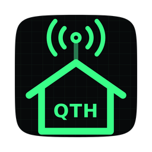

<h1 align="center">QTHome</h1>

<i>The Home of OM</i> <i>Un solo programma per tutta la stazione radioamatoriale · One program for the whole amateur radio station</i>

---

## Download

| | **Mac** (chip Apple e Intel) | **Windows 10/11** |
|---|---|---|
| **QTHome** | [**Scarica QTHome per Mac**](https://github.com/SculptWorksLTD/QTHome/releases/latest/download/QTHome-Mac.pkg) | [**Scarica QTHome per Windows**](https://github.com/SculptWorksLTD/QTHome/releases/latest/download/QTHome-Windows.zip) |
| **QTHome Trainer** (beta tester) | [**Scarica il Trainer per Mac**](https://github.com/SculptWorksLTD/QTHome/releases/latest/download/QTHome-Trainer-Mac.pkg) | [**Scarica il Trainer per Windows**](https://github.com/SculptWorksLTD/QTHome/releases/latest/download/QTHome-Trainer-Windows.zip) |

I link scaricano sempre l'ultima versione. QTHome si aggiorna da solo: lascialo collegato a internet e riavvialo quando lo chiede.
*The links always download the latest version. QTHome updates itself: keep it online and restart it when asked.*

**Prima apertura.** Mac: se il sistema blocca il programma, vai in *Impostazioni di Sistema → Privacy e sicurezza* e premi **Apri comunque**.
Windows: apri lo zip, avvia il programma e, se compare l'avviso, scegli **Ulteriori informazioni → Esegui comunque**.

> Versione di prova: QTHome è in sviluppo, la prima versione completa arriva nel 2027.

## Cos'è

QTHome riunisce in **un'unica finestra** tutto quello che serve a una stazione radioamatoriale: controllo delle radio,
CW, modi digitali, log e, passo dopo passo, fonia, cluster e propagazione, SDR, satelliti, remoto e contest. Pensato per tutti, anche per chi vede poco: ogni cosa si usa da tastiera e si può ascoltare.

Tutto il lavoro è fatto da **QTEngine**, il motore di QTHome, che contiene The Rigger e il decoder CW di CWIU1MVI.

## Cosa fa

- **Stazione** – le radio si collegano da sole (The Rigger integrato): frequenza, modo, S-meter, PTT, e i programmi esterni (WSJT-X, JTDX, fldigi, N1MM…) agganciati senza configurazioni.
- **CW** – decoder e tastiera CW di CWIU1MVI; la decodifica CW resta **gratis per sempre**.
- **Modi digitali** – FT8 e FT4 in ricezione con il decoder di QTEngine, nato in casa. RTTY, PSK, SSTV e APRS in arrivo.
- **Log e QSL elettroniche** – ogni QSO registrato da solo, import/export ADIF; invio a LoTW, eQSL, QRZ e Club Log.
- **Fonia, cluster, SDR, satelliti, rotore, contest** – registrazioni e memorie voce; DX cluster e RBN con dati solari; ricevitore con la chiavetta RTL-SDR; passaggi e Doppler; rotore verso un locatore; log da contest con Cabrillo.
- **QTHome Chat** – stanze di testo e di voce tra OM, messaggi privati cifrati.
- **Accessibilità** – S-meter e frequenza a voce o in Morse, navigazione completa da tastiera, lettori di schermo.
- **Segnalazioni** – un tasto per mandare in modo anonimo un problema o un'idea.
- **9 lingue** – italiano, inglese, francese, tedesco, spagnolo, portoghese, giapponese, russo e cinese.

Manuale: [italiano](docs/manuale-it.md) · [English](docs/manuale-en.md) · [Français](docs/manuale-fr.md) · [Deutsch](docs/manuale-de.md) · [Español](docs/manuale-es.md) · [Português](docs/manuale-pt.md) · [日本語](docs/manuale-ja.md) · [Русский](docs/manuale-ru.md) · [中文](docs/manuale-zh.md)

## QTHome Trainer

Un piccolo programma per i **beta tester**: ascolta la radio insieme a te e allena i decoder di QTHome. FT8 e FT4 si
confrontano con WSJT-X, il CW e lo skimmer con la chiavetta SDR con il Reverse Beacon Network. Non trasmette e non comanda la radio. Manda solo dati anonimi, mai il tuo nominativo;
gli spezzoni audio solo se acconsenti. Serve WSJT-X installato (gratuito).

Guida: [italiano](docs/trainer-it.md) · [English](docs/trainer-en.md) · [Français](docs/trainer-fr.md) · [Deutsch](docs/trainer-de.md) · [Español](docs/trainer-es.md) · [Português](docs/trainer-pt.md) · [日本語](docs/trainer-ja.md) · [Русский](docs/trainer-ru.md) · [中文](docs/trainer-zh.md)

## Gratis e PRO

30 giorni di prova completa. Poi QTHome resta **gratis per ascoltare e decodificare**; con **PRO a 12 € all'anno** si
trasmette, si automatizza e si mandano le QSL online. The Rigger resta gratis per sempre.

## Requisiti

- **Mac** con macOS 11 o successivo (chip Apple o Intel) oppure **Windows 10/11**.
- La radio collegata al computer (USB o scheda audio), come per WSJT-X.

---

## What it is

QTHome puts everything an amateur radio station needs in **one window**: radio control, CW, digital modes, logging and,
step by step, voice, cluster and propagation, SDR, satellites, contests and an assistant running on your computer.
Made for everyone, including visually impaired operators: everything works from the keyboard and can be heard.

**Main features:** automatic radio connection (The Rigger built in) · CW decoder, free forever · FT8/FT4 receive with our own
decoder · automatic logging with ADIF · S-meter and frequency by voice or Morse · electronic QSLs · cluster, SDR, satellites, rotator, contest · anonymous reports · 9 languages.
Manual: [English](docs/manuale-en.md).

**QTHome Trainer** is a small app for beta testers: it listens along with you and trains our decoders: FT8/FT4 against
WSJT-X, CW and the SDR skimmer against the Reverse Beacon Network. It never transmits. Guide: [English](docs/trainer-en.md).

**Requirements:** a Mac with macOS 11 or later (Apple or Intel) or Windows 10/11, with the radio connected as for WSJT-X.

---

QTHome, QTHome Trainer e QTEngine · © 2026 Enrico Migliorati (IU1MVI). Tutti i diritti riservati / All rights reserved. Software proprietario:
copia, distribuzione e modifica non consentite senza autorizzazione scritta del titolare. Questo repository contiene solo gli installer,
la documentazione e il canale degli aggiornamenti. Software di terze parti: [docs/terze-parti.md](docs/terze-parti.md) ·
[Sostieni con PayPal](https://paypal.me/nerosdmf)
